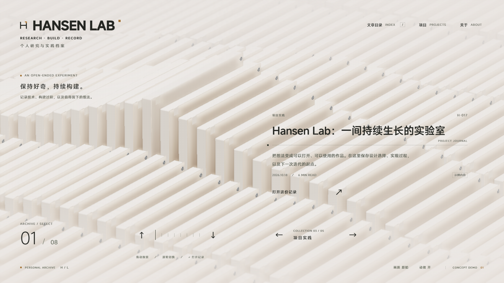

# Hansen Lab

GitHub 私有仓库：[Sonderhs/HansenLab](https://github.com/Sonderhs/HansenLab)。

个人研究与实践档案。以技术笔记、项目过程与实验记录为主，也保留生活随笔。

首页保留可拖动的三维玻璃档案阵列；文章使用独立阅读界面，提供目录、代码复制、阅读进度与下一篇。支持文章搜索、分类筛选、键盘导航和手机布局。



## 本地运行

需要 Node.js 22.12 或以上版本（已使用 Node.js 24 验证）。

```powershell
npm ci
npm run dev
```

打开 http://127.0.0.1:5175/ 。这是独立项目，不需要 RhineLabUI 目录、其 node_modules 或本地服务。

```powershell
npm run build
npm run preview
```

静态产物位于 `dist/`。默认部署在站点根路径；子路径部署可在构建时设置 `HANSEN_BASE=/HansenLab/`。文章采用 `#post/lab-017` 形式的链接，无需服务端路由回退。

## 使用与内容

- 首页拖动、滚轮、方向键切换；Enter 打开文章；`/` 搜索，Esc 返回。
- `src/data.ts` 保存全部示例文章、分类和三维位置映射。
- `src/main.ts` 管理页面交互，`src/style.css` 管理博客布局，`src/scene.ts` 管理三维场景。
- `public/assets/` 为模型，`art/` 为对应 Blender 源文件与脚本。

当前 40 篇文章的标题、日期、阅读时长和正文均为演示内容，页面已标明。五类 × 八篇是现阶段的阵列适配；任意数量文章、Markdown 内容流程、个人介绍与正式部署仍待后续完善。

## 画质与验证

默认原始画质，页脚可手动切换流畅档。文章、目录及隐藏标签页暂停三维绘制，返回后恢复。开发模式 `/?profile=1` 可测量场景；`/?profile=baseline` 可作性能对照，生产构建不提供探针。Chrome 的实际帧率也受 Windows 给浏览器分配的 GPU 影响。

使用 Playwright CLI 复用现有检查（先启动开发服务）：

```powershell
npx --yes --package @playwright/cli playwright-cli --session hansen open http://127.0.0.1:5175/
npx --yes --package @playwright/cli playwright-cli --session hansen run-code --filename checks/browsing.js
npx --yes --package @playwright/cli playwright-cli --session hansen run-code --filename checks/interaction.js
npx --yes --package @playwright/cli playwright-cli --session hansen close
```

`checks/rendering.js` 提供渲染前后像素对照；`checks/gpu.js` 与 `checks/runtime.js` 提供开发机性能测量。历史测试见 [docs/DEMO-HISTORY.md](docs/DEMO-HISTORY.md)，独立项目验收见 [verification/STANDALONE.md](verification/STANDALONE.md)。

## 来源与许可

本项目从 [LBEILC/RhineLabUI](https://github.com/LBEILC/RhineLabUI) 的 Hansen Lab 实验版本拆出，复用其三维引擎、交互及 Blender 模型。保留原 MIT 署名，字体遵循单独许可，详细来源见 [NOTICE.md](NOTICE.md)。
