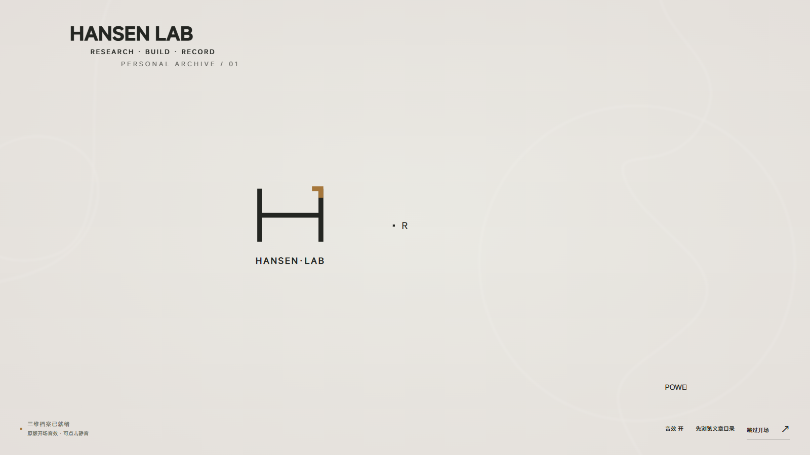

# 开场音效

2026-10-22。用户要求在 Hansen Lab 加载动画中恢复原项目音效。

## 行为

自动画面沿用约 20 秒的原时间轴，首次静音且不创建 AudioContext。「开启音效并重播」通过真实点击解锁声音，从起点同步重播，覆盖逐字输入、标志、两次验证、扫描、欢迎和两次文字出现。播放中的同一按钮可以立即静音；页脚音效开关保存偏好，重播开场时应用。新页面即使保存开启，也仍需点击以满足浏览器播放策略。键盘可聚焦按钮并用 Enter 或 Space 启动。

首页完成、跳过、提前打开目录／正文、场景失败和减少动态效果均停止声音；后台暂停 AudioContext，返回从当前动画位置继续，不补播跳过的声音。音频设备失败或 1.5 秒内无法启用时，显示重试并继续无声动画和阅读。等待真实三维资源时不重复播放欢迎声音。

没有接入背景音乐或全局模型／正文交互声音。音量与压限沿用原项目 soundVolume=0.55、master=0.8；三维画质与运动规则未改动。

## 来源与实现

- src/audio-synthesis.ts 提取原项目 src/audio.ts 的音效合成器及提示时刻，保留音色参数。
- src/typing-samples.ts 为原项目三个 38ms 短音；src/typing-rhythm.ts 复用逐字揭示节奏，原片故障闪动恢复不触发打字音。原作者权利保留，来源和剪切参数见 public/audio/typing-source.json，复现脚本为 scripts/extract-typing-audio.mjs。
- src/boot-audio.ts 仅管理开场音效、静音偏好、播放策略及设备释放；src/boot-intro.ts 按渲染时间推进音效，不另开独立计时器。
- 精确来源哈希见 docs/SOURCE-MANIFEST.json；授权范围说明见 NOTICE.md。此变更覆盖 BOOT-INTRO.md 历史记录中「未使用片头音频」的描述，仅增加上述短音。

## 验证

- checks/boot-audio.js：24 项通过。实际 AudioContext 经主输出 AnalyserNode 检测到非零采样；整段自然播放触发 key 55 次、brand 1 次、confirm 2 次、scan 1 次、welcome 1 次、text-reveal 2 次，结束停止且设备 suspended。
- 覆盖首访静音且无音频设备、点击解锁、偏好记忆、重播、即时静音、跳过无补播、提前阅读、文章直达和减少动态效果无音频设备、可控设备异常和文章仍可访问。
- 320×700、390×844、844×390 的音效／跳过／目录按钮可见且无横向溢出。后台暂停使用合成 document.hidden/visibilitychange 验证，不声称是真实手机后台测试。
- 声音来源参数和信号输出已验证；最终听感仍由用户试听确认。

补充验收：最终 `npm run build` 通过；`checks/boot.js` 22 项、`checks/loading.js` 11 项、`checks/boot-layout.js` 3 项通过。`checks/boot-audio-production.js` 在端口 4185 的最终静态包上通过 9 项：键盘启动实际声音、静音、跳过、目录入口、设备启动超时及超时后恢复／启动中跳过均正常，无页面错误或本站资源失败，生产包不暴露开发探针。三个打字短音的源文件与原项目 SHA256 完全一致。
