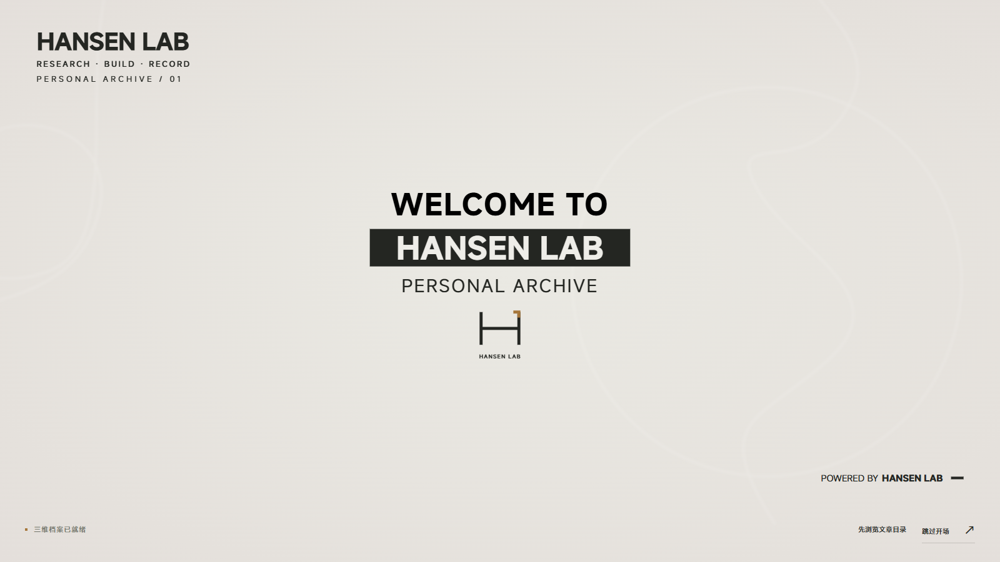

# Hansen Lab 开场与真实加载

2026-10-22。复用 RhineLabUI 的原生 DOM/SVG 动效轨迹，新增 Hansen Lab 品牌与独立加载控制器。

## 体验

首页自动播放约 20 秒：逐字访问提示、Hansen 标志绘制、连接信息、圆环扫描与环绕点、欢迎页，最后淡入三维首页。开场采用 MiSans 和本站 H 标志；未使用原项目的授权 Novecento、片头音频或参考视频背景。

- 「跳过开场」、Esc 或 Enter 跳过动画，仍等待真实场景载入。「先浏览文章目录」或 / 可直接阅读，模型稍后载入也不会打断正文。
- 文章直达链接与刷新直接进入正文。页脚「重播开场」在三维载入后可用，选档保持；开场期间隔离主页输入，结束恢复焦点。
- 减少动态效果采用静态加载页，播放期间变更系统偏好也会生效。隐藏标签页暂停 SVG 时间轴；开场期间不持续绘制三维。
- 资源慢时停在欢迎画面，跳过不会伪造加载完成。资源或首帧失败提供重试及文章入口。
- 首页导航与正文等原交互继续沿用。竖屏采用居中紧凑构图，背景与控件铺满视口；320px 手机页脚保留重播、画质与动效入口，隐藏演示版本小字以避免拥挤。

## 实现

src/boot-intro.ts / .css 管理绘制、真实准备状态、跳过、重播和过渡；src/boot-motion.ts 等四个轨迹模块保留原片测量的节奏，文字已改为个人档案语境。index.html 提供无需等待主脚本的静态占位。

三维资源与开场并行准备，字体等待有 2.5 秒兜底并保留系统字体。首帧在开场结束或跳过后、遮罩淡出前准备，避免着色器编译跨过标志与扫描阶段，或过早淡出到空画布。未修改模型、画质预设、镜头与阵列运动规则。

来源文件提取前的哈希追加到 docs/SOURCE-MANIFEST.json；署名见 NOTICE.md。

## 验证

- npm run build：TypeScript 与生产包构建通过。
- checks/boot.js：22 项通过，包括完整阶段播放、开场期间无连续三维绘制、自然结束、重播跳过、焦点恢复、文章直达刷新、系统减少动态效果，以及 390×844 / 320×700 / 844×390 控件与完整构图范围。
- checks/loading.js：11 项通过。拦截 GLB 进行真实延迟与失败测试，确认欢迎页等待、输入隔离、跳过仍等待资源、提前阅读不被后续载入打断、失败后重试入口与正文可读，以及中途减少动态效果。
- checks/boot-layout.js：320px 页脚三项控制完整可点；合成 visibilitychange 事件配合 document.hidden 状态验证时间轴暂停及恢复。此项为合成状态测试，不声称是真实手机或系统后台性能测量。桌面欢迎、扫描与手机欢迎截图已目视复核。
- checks/boot-first-frame.js：受控首帧异常后释放输入、显示重试、文章可读且无未捕获异常。
- checks/browsing.js 与 checks/interaction.js：原有 26 项浏览和 8 项渲染／画质／低帧率检查通过，使用真实跳过按钮进入首页。
- 生产包验证：根路径开场与跳过、文章直达、减少动态效果、字体与模型请求均正常；生产页面不暴露开发探针。

开发服务启动后，可使用 README 中的 Playwright CLI 命令，将脚本改为上述 checks/ 文件重放。检查文件需保持裸函数表达式，已从 Prettier 默认格式化排除，以避免自动插入的分号破坏 CLI 输入。

完整开场保留原项目节奏，动画时长属于设计选择；低速资源仍可能延长等待。用户尚未确认最终开场观感。
