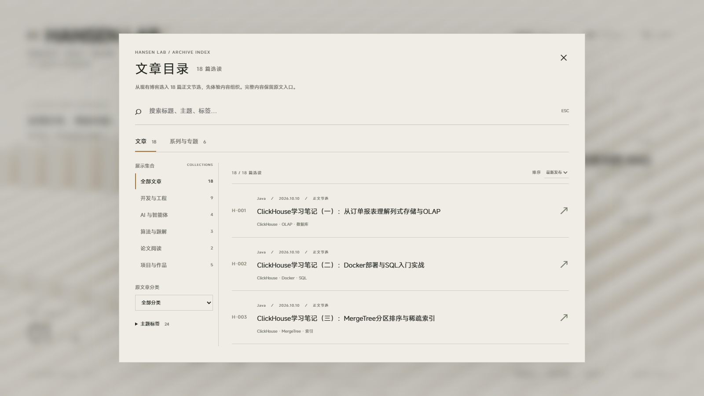

# 内容组织与选读原型

2026-10-22，Hansen Lab 独立仓库。

## 交付范围

从用户备份的 390 篇已发布文章中只读选取 18 篇，保存 7 个原分类、26 个原标签，界面合并别名后显示 24 个标签。保留标题、日期、元数据、原文路径和来源哈希；正文为明确标识的节选，未复制完整图片、PDF、草稿或服务配置。

五个首页集合为开发与工程、AI 与智能体、算法与题解、论文阅读、项目与作品。完整选读集合分别包含 9 / 4 / 3 / 2 / 5 篇，允许交叉；首页精选位置为 6 / 4 / 3 / 2 / 5，共 20 个位置对应 18 篇唯一文章。

六个系列／专题：ClickHouse 学习笔记、Go 并发与面试、Neko 博客助手、黑马点评实践、苍穹外卖实践、算法入门选读。学习项目与个人项目分开标明；有原系列总数时展示选入数量，不生成未迁入文章的虚假链接。

## 行为

目录支持展示集合、原分类、多个标签交集、关键词和发布时间排序，以及清空与移除筛选；系列按指定阅读顺序排列。正文提供分类／标签／系列入口、系列前后篇、原文链接与节选说明。弹窗关闭保留阅读位置。

三维每列篇数独立，列内记忆与连续循环保留；跨集合的同篇文章使用同一个正文路由并优先保持当前集合。大坐标归齐按各列数量的最小公倍数进行，防止原固定八行周期导致条目错配。模型、相机、材质与画质预设保持。

真实长标题按实际字宽决定换行，短标题保留原滚动文字；标题不改变源文章文本。首页摘要最多显示三行，阅读页保留当前节选摘要。

## 验证

- npm run build：TypeScript 与 Vite 生产构建通过。
- checks/catalog.js：38 项流程与数据不变量检查通过，覆盖唯一计数、多维交集、标签别名、系列顺序、原文路径、正文入口、读后返回、集合记忆、负行号与循环重定位，以及 390×844、320×700、844×390 的目录和正文无横向溢出。
- checks/browsing.js：原有 26 项浏览、搜索、直达刷新、关于弹窗、输入恢复和响应式检查通过，已替换旧虚构文章断言。
- 目录重置返回两个面板顶部并恢复搜索焦点；筛选保持键盘焦点，发布时间正反序可用；Neko 的 AI 与项目入口使用同一路由并保留上下文。
- 长论文标题在 1600×900、1280×720、390×844、320×700 与 844×390 范围内换行，不造成横向溢出。窄横屏沿用首页最小高度，可纵向浏览。
- 桌面首页、目录、系列、节选正文与手机目录截图已目视复核。

此轮用于用户体验确认，尚未全量迁移，也未建立完整 Markdown／公式／资源渲染和正式内容发布流程。原始备份保持不变。

## 补充验收

- `checks/catalog-layout.js`：12 项通过，覆盖筛选重置、焦点、时间排序、集合上下文与长标题布局。
- `checks/catalog-title.js`：长标题切回短标题后，原滚动标题布局正常。
- `checks/interaction.js`：8 项通过，覆盖弹窗与阅读暂停三维、返回恢复、画质切换与低帧率抽取。
- `checks/catalog-production.js`：使用 `npm run preview -- --host 127.0.0.1 --port 4185`，7 项生产包检查通过。目录只有 18 篇选读，分类与系列可用，正文节选及系列导航正常，文章深链跳过开场；没有页面脚本错误或本站资源请求失败，生产环境不暴露开发探针。
- 18 份源文章的 SHA256 与备份再次核对一致；未写入备份目录。
- README 首页图已更新为本次生产包截图；目录截图如下。

